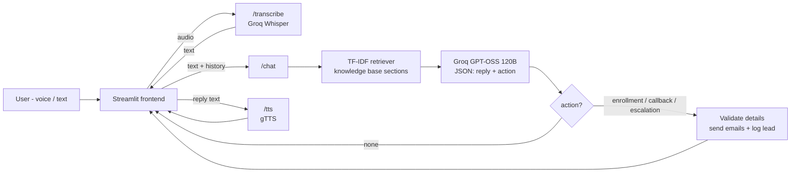

# Evo11ve AI Skills - Voice Assistant

A voice + text chat assistant that answers questions about Evo11ve's **AI Skills Program** ([evo11ve.ai/for-ai](https://evo11ve.ai/for-ai)) and sends emails automatically for enrollment requests, callback requests and escalations to a human.

**Live app:** https://evo11ve-ai-skills-assistant.streamlit.app
**API:** https://evo11ve-assistant-api.onrender.com (`/docs` for Swagger)

> The API runs on Render's free plan, so it sleeps when idle - the first question after a while can take ~30-50 seconds.

---

## Features

- **Voice in, voice out** - record a question with the mic, it gets transcribed (Whisper), answered, and the answer is read back (gTTS, Indian English voice). Typing works too.
- **Answers only from the program page** - the page content is stored as a small knowledge base; relevant sections are retrieved and passed to the LLM. If something isn't on the page (batch dates, EMI, refunds) the bot says so and offers a callback instead of guessing.
- **Automatic emails** - the LLM detects the user's intent and returns a structured action:
  - `enrollment` - confirmation email to the parent + alert to the team
  - `callback` - confirmation to the user + callback details to the team
  - `escalation` - acknowledgement to the user + full chat transcript to the team
- **Confirm before sending** - since voice can mishear emails ("ravi at gmail dot com"), the assistant reads the details back and only acts after the user says yes. The backend also validates name/email/phone before sending.
- **No duplicate emails** - actions already done in the session are tracked and not triggered again.
- **Lead log** - every action is saved to `leads.csv`, viewable at `/leads?key=ADMIN_KEY`.
- **Quick question buttons** and a **Talk to a human** button in the sidebar.
- Works without email credentials (emails are "simulated" and printed to the logs) so it can be demoed easily.

## Architecture



### AI workflow (one turn)

1. User speaks -> Streamlit `st.audio_input` records it -> `POST /transcribe` -> Whisper (`whisper-large-v3-turbo`) returns text.
2. `POST /chat` with the message + chat history.
3. The retriever picks the top matching sections of `knowledge_base/ai_skills_program.md` (TF-IDF, cosine similarity). The previous user message is included in the query so follow-ups like "how much is it?" still work.
4. The LLM gets a system prompt with rules + the retrieved context and must reply in JSON:
   `{"reply", "action", "name", "email", "phone", "student_class", "project", "preferred_time", "note"}`
5. If `action` is not `none`, the backend checks the required details, sends the emails and saves the lead.
6. The reply is shown in the chat and converted to speech with `POST /tts`.

Why TF-IDF and not embeddings? The knowledge base is a single page (~15 sections), so keyword retrieval works well and keeps the deployment small (no PyTorch / model download), which matters on free hosting. It can be swapped for FAISS + sentence-transformers if the content grows.

## Tech stack

| Part | Tool |
|---|---|
| Backend API | Python 3.10+, FastAPI |
| Frontend | Streamlit |
| LLM | Groq - GPT-OSS 120B (JSON mode, low reasoning effort) |
| Speech-to-text | Groq - Whisper large v3 turbo |
| Text-to-speech | gTTS |
| Retrieval | scikit-learn TF-IDF |
| Email | Brevo API (deployment) or SMTP / Gmail (local) |
| Hosting | Render (API) + Streamlit Community Cloud (UI) |

## Project structure

```
evo11ve-voice-assistant/
├── backend/
│   ├── main.py            # FastAPI app and endpoints
│   ├── rag.py             # knowledge base loading + retrieval
│   ├── llm.py             # Groq chat + Whisper calls, system prompt
│   ├── emailer.py         # email sending + templates
│   ├── knowledge_base/
│   │   └── ai_skills_program.md
│   ├── requirements.txt
│   └── .env.example
├── frontend/
│   ├── app.py             # Streamlit UI
│   ├── requirements.txt
│   └── .streamlit/secrets.toml.example
├── render.yaml
└── README.md
```

## Run locally

You need a free Groq API key from https://console.groq.com/keys

```bash
git clone <this repo>
cd evo11ve-voice-assistant

# backend
cd backend
python -m venv venv
venv\Scripts\activate        # Windows  (Mac/Linux: source venv/bin/activate)
pip install -r requirements.txt
copy .env.example .env       # Mac/Linux: cp .env.example .env  -> then fill in GROQ_API_KEY
uvicorn main:app --reload --port 8000
```

In a second terminal:

```bash
cd frontend
pip install -r requirements.txt
streamlit run app.py
```

Open http://localhost:8501. The frontend uses `http://localhost:8000` by default (change it with the `API_URL` env variable or Streamlit secret).

## Environment variables (backend)

| Variable | Needed | What it is |
|---|---|---|
| `GROQ_API_KEY` | yes | Groq API key |
| `BREVO_API_KEY` | for emails on Render | Brevo API key (free plan: 300 emails/day) |
| `SMTP_USER`, `SMTP_PASSWORD` | for emails locally | Gmail address + [app password](https://myaccount.google.com/apppasswords) |
| `SENDER_EMAIL` | with Brevo | Sender address (must be verified in Brevo) |
| `TEAM_EMAIL` | optional | Inbox that gets enrollment / callback / escalation alerts (defaults to the sender) |
| `ADMIN_KEY` | optional | Enables `/leads?key=...` |
| `GROQ_CHAT_MODEL`, `GROQ_STT_MODEL` | optional | Override the default models |

If no email settings are given, emails are simulated (printed in the backend logs).

## Deployment

**Backend on Render**
1. Push the repo to GitHub.
2. Render -> New -> Blueprint -> select the repo (it reads `render.yaml`). Or create a Web Service with root directory `backend`, build `pip install -r requirements.txt`, start `uvicorn main:app --host 0.0.0.0 --port $PORT`.
3. Add the environment variables above. Use **Brevo** for email here - Render's free plan blocks SMTP ports.
4. Check `https://<your-app>.onrender.com/health`.

**Frontend on Streamlit Community Cloud**
1. https://share.streamlit.io -> New app -> pick the repo, main file `frontend/app.py`.
2. In Advanced settings -> Secrets add: `API_URL = "https://<your-app>.onrender.com"`
3. Deploy.

Note: the free Render instance sleeps after inactivity, so the first request can take ~30-50 seconds.

## Limitations / next steps

- The knowledge base is a manual copy of the program page - a scheduled scraper could keep it updated.
- Chat history lives in the browser session only; a database (e.g. SQLite/Postgres) could store conversations and leads properly.
- Voice replies use gTTS; a neural TTS voice would sound more natural.
- Could add Tamil / Hindi support (Whisper already understands them).
